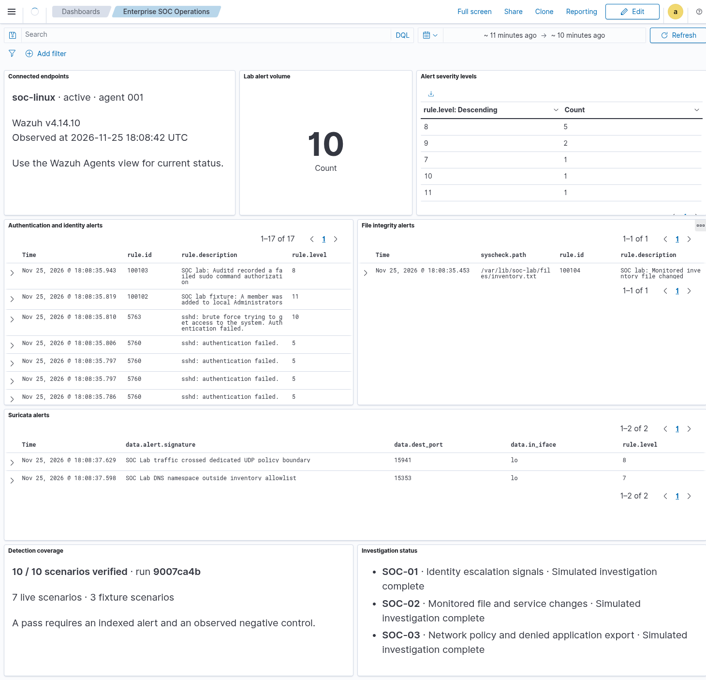

# Enterprise SOC & Detection Engineering Lab

A single-host SOC lab for tracing Linux and network telemetry from collection to an indexed Wazuh alert, then using the evidence in an incident investigation. It runs on Fedora with rootless Podman and KVM.

## Verified results

| Check | Result |
| --- | --- |
| End-to-end detection | **10/10** in run `9007ca4b`. Ten indexed positives, 17 manager records across ten negative controls, zero control target matches, and zero unattributed target matches. |
| Native Wazuh Logtest | **6/6** archived inputs. D03, D05 and D09 each had a positive and a control. |
| Local automated validation | **25 tests passed** plus static rule, endpoint, image digest and script checks. |
| Incident response | **Three simulated investigations** with findings, timelines, containment decisions and evidence references in Markdown and PDF. |

Seven scenarios generated live telemetry on the Debian guest. Three used labeled log fixtures: SSH correlation, Windows Security 4732 and Sysmon ProcessCreate. Wazuh decoded and indexed the Windows-shaped fixtures from Linux. Native Windows and Sysmon collection is a future milestone for a dedicated authorized guest.

[Accepted run](docs/evidence/run-9007ca4b.json) · [Native replay](docs/evidence/logtest-9007ca4b.json) · [Baseline run](docs/evidence/run-0cee9232.json) · [Detection coverage matrix](docs/detection-coverage.md)

## Architecture

| Component | Role |
| --- | --- |
| Wazuh 4.14.10 | Manager and Filebeat for detection and delivery, one indexer, and HTTPS dashboard |
| Dedicated Debian guest | Wazuh agent, file integrity monitoring, Auditd, rsyslog, and a small test application |
| Suricata | Passive EVE JSON collection on the guest's loopback network |
| Windows and Sysmon | EventChannel-shaped detection fixtures and a dedicated-guest onboarding guide |

The dashboard listens on `https://127.0.0.1:8443`. The indexer and manager API stay on an internal Podman network. The Debian guest sends authenticated agent traffic through a loopback-only relay. Suricata captures the exercise traffic on the guest loopback interface.

The central services share a single host and indexer. This lab validates detection behavior for the observed exercise traffic. Wider sensor placement, operator access controls, telemetry loss monitoring and capacity tests are future work. [Architecture and data flow](docs/architecture.md) · [Deployment decision](docs/adr-001-deployment.md) · [Security limitations](SECURITY.md)

During the accepted run, seven samples showed the indexer using 1.095–1.098 GB RAM, the manager using 36.95–55.03% CPU, and the guest using 369.7–370.3 MiB resident memory. The guest overlay occupied 484 MiB. [Measurement method and per-service results](docs/resources.md)

## Reproduce locally

For a new installation, follow the deployment guide for Fedora dependencies, private credentials and PKI, and Linux guest enrollment. In the project root, run the same static and unit checks as CI. [Deployment guide](docs/deployment.md) · [Troubleshooting](docs/troubleshooting.md)

~~~sh
python3 -m venv .venv
. .venv/bin/activate
python -m pip install -r requirements.txt
python3 -B scripts/validate.py
python3 -B -m unittest discover -s tests -v
~~~

Once the stack and Linux endpoint are provisioned, require an active endpoint and run the detection exercise.

~~~sh
./scripts/soc.sh health --wait 120 --require-agent soc-linux &&
python3 -B scripts/run_scenarios.py
~~~

The runner saves indexed alert references and control receipt evidence under the ignored `local-results/` directory. Keep raw archives, credentials, keys and guest disks private.

## Dashboard and investigations

The Operations dashboard shows the accepted run's volume, alert severity, file integrity, authentication and Suricata results alongside the coverage and case summaries.

The live Agents page showed `soc-linux` active on Debian 12. The screenshot masks the agent IP address. [Agents capture](docs/evidence/screenshots/agents-9007ca4b.png)

| Investigation | Evidence |
| --- | --- |
| SOC-01 · Identity escalation signals | [Report](docs/incidents/01-identity.md) · [PDF](docs/incidents/01-identity.pdf) |
| SOC-02 · File and service changes | [Report](docs/incidents/02-integrity.md) · [PDF](docs/incidents/02-integrity.pdf) |
| SOC-03 · Network policy and denied export | [Report](docs/incidents/03-network-policy.md) · [PDF](docs/incidents/03-network-policy.pdf) |

## Demonstration and interview

[Five-minute demo](docs/demo.md) · [20 interview questions and answers](docs/interview.md) · [CV and LinkedIn copy](docs/portfolio.md) · [Resource measurements](docs/resources.md)

[Windows and Sysmon future milestone](endpoints/windows/README.md) · [Roadmap](ROADMAP.md) · [Engineering progress](PROGRESS.md) · [Handoff](HANDOFF.md)
