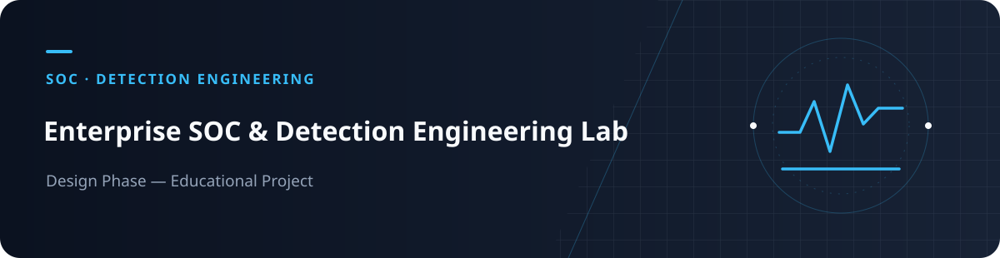
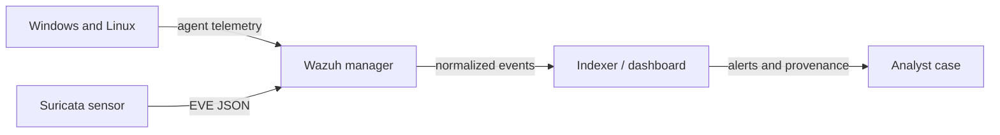

# Enterprise SOC & Detection Engineering Lab

**Design Phase — Educational Project**

Design a small SOC that traces an endpoint or network event through collection, detection, analyst triage and a defensible incident decision.

## Why this project

A dashboard can show activity while silently losing fields or duplicating events. The lab makes event coverage, false positives and the quality of analyst decisions measurable.

- Trace Windows, Linux and network signals from raw evidence to a case.
- Explain when a single event warrants triage and when corroboration changes priority.
- Quantify coverage, detection latency and false alerts against a labeled replay.

## Proposed system

Run two KVM networks: an endpoint segment for Windows and Linux, and a restricted management segment for the Wazuh manager/indexer/dashboard and analyst workstation. Mirror the endpoint segment to Suricata through a receive-only capture path. Agents and the sensor can reach only the collector ingress. Restrict the dashboard and indexer to management access. Use private time synchronization and an explicitly bounded update window. Document that intra-host traffic invisible to the mirror is an expected coverage gap.

**Design trade-off.** A single Wazuh node keeps the lab affordable and creates a known single point of failure; measure backlog recovery before considering a separate indexer. Suricata gives protocol and signature context while endpoint events carry identity and process provenance. Keep Sigma translation reviewable and write native correlation only where the translation loses intent.

## Engineering stack

Wazuh integrates agent enrollment, a manager, indexer and dashboard for a compact SOC. Suricata contributes EVE JSON network metadata. Sysmon and Windows Security channels capture complementary process and identity events; Linux Auditd supplies syscall-derived records. Sigma expresses detection intent portable across backends, but mappings and rule semantics must be tested in Wazuh. Wireshark is reserved for manual packet review and Python for fixture normalization and metrics. KVM/QEMU provides isolated, reproducible endpoints.

## Trust and technical challenges

- **Collector spoofing** across endpoint to manager. Allowlisted agent enrollment, per-source identity, restricted ingress.
- **Log loss or clock drift** across sensor and indexer. Time health, sequence gaps, queue alarms.
- **Analyst exposure** across index to dashboard. Scoped read role, redacted fields, retention controls.
- **Alert floods** across rules to case queue. Deduplication and noise thresholds.

## Lab and acceptance

Starting estimate: 8 logical cores, 24 GB RAM and 160 GB SSD. Budget 8 GB for central Wazuh, 6 GB for Windows, 2 GB each for Linux and sensor, with remaining headroom for host and analyst. Set ingestion quotas and a seven-day fixture retention ceiling. Acquire legitimate OS images, KVM snapshots and a private virtual switch.

Use five controlled scenarios built from labeled benign activity and fixture logs: S1 approved support-account sign-in sequence, S2 monitored service/job change, S3 synthetic DNS and connection burst, S4 test policy-file change, and S5 simulated telemetry interruption. Record negative controls from normal admin/backup operations. Future target: at least 95% event coverage (indexed expected records / emitted expected records), p95 event-to-alert latency ≤60 seconds at a documented ingest rate, and ≤2% false-positive test windows (alerted benign windows / all benign windows). Score each investigation 0–2 for timeline, provenance, competing explanation, scope and response rationale. Target ≥8/10 per scenario. Record clock skew and report sample counts and dropped data alongside metrics.

## Delivery and professional skills

Network diagram, source onboarding checklist, normalization map, ten reviewed detection specifications, five replay manifests, triage dashboard, incident playbooks and a detection quality report.

Telemetry engineering, network monitoring, detection tuning, incident triage, threat hunting and response documentation.

Phase 0 design is documented. The [roadmap](ROADMAP.md) tracks four future stages, from a minimal prototype through validation and evidence publication.

## Scope and ethics

Collect telemetry from enrolled training machines only. Keep raw captures and account identifiers in the lab and publish aggregate, approved measurements.

## Design references and navigation

- [Architecture](docs/architecture.md) · [Technical design](docs/technical-design.md) · [Threat model](docs/threat-model.md)
- [Learning objectives](docs/learning-objectives.md) · [Testing strategy](docs/testing-strategy.md) · [Lab requirements](docs/lab-requirements.md)
- [Official references](docs/references.md) · [Evidence template](templates/detection-review.md) · [Security](SECURITY.md)
- [Back to the portfolio](https://github.com/Hrr-Yassin)
