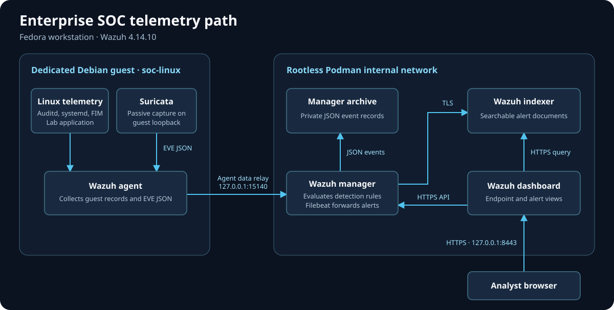
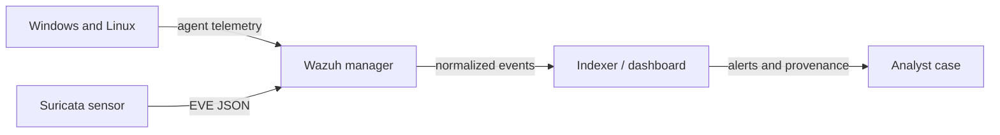

# Architecture

**Proposed topology**

Run two KVM networks: an endpoint segment for Windows and Linux, and a restricted management segment for the Wazuh manager/indexer/dashboard and analyst workstation. Mirror the endpoint segment to Suricata through a receive-only capture path. Agents and the sensor can reach only the collector ingress. Restrict the dashboard and indexer to management access. Use private time synchronization and an explicitly bounded update window. Document that intra-host traffic invisible to the mirror is an expected coverage gap.

| Source | Destination | Interface or record |
| --- | --- | --- |
| Windows and Linux | Wazuh manager | agent telemetry |
| Suricata sensor | Wazuh manager | EVE JSON |
| Wazuh manager | Indexer / dashboard | normalized events |
| Indexer / dashboard | Analyst case | alerts and provenance |

## Decision and limitation

A single Wazuh node keeps the lab affordable and creates a known single point of failure; measure backlog recovery before considering a separate indexer. Suricata gives protocol and signature context while endpoint events carry identity and process provenance. Keep Sigma translation reviewable and write native correlation only where the translation loses intent.

See [security boundaries](threat-model.md) and [deployment assumptions](lab-requirements.md).
